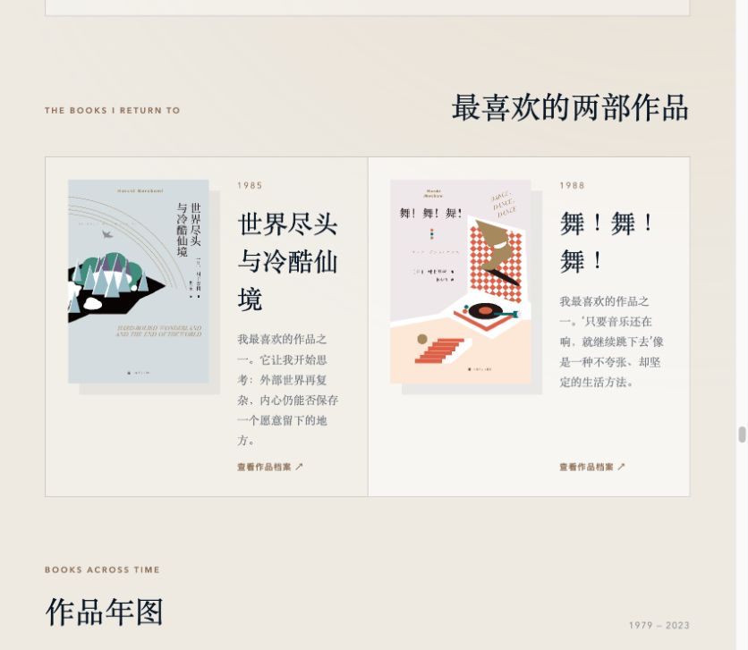
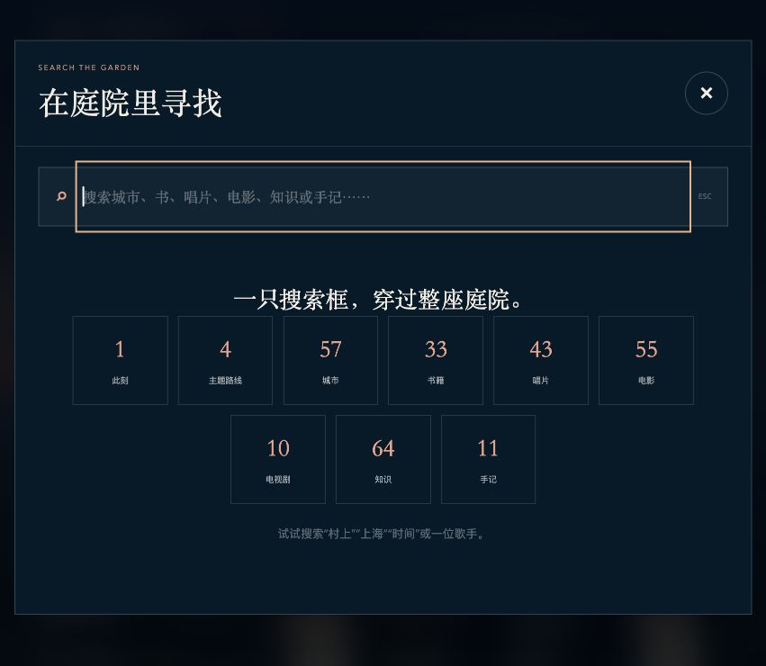

# 深绘里｜Sehuri's Digital Garden

> 在自己的世界里，慢慢生长。

「深绘里」是我的个人数字庭院。

我把旅行、阅读、知识、音乐、影视和随手写下的文字放在这里，让散落在不同地方的收藏拥有同一个入口。它不是一份静止的个人简历，而是一个会随着生活持续变化的长期项目。

## 访问网站

- [GitHub Pages · 深绘里](https://sehuri.github.io/)
- [ChatGPT Sites · 深绘里](https://shenhuili-digital-garden.shenhuil.chatgpt.site/)
- [此刻 / NOW](https://sehuri.github.io/now/)

## 网站实景

以下为当前版本的真实页面截图，拍摄于 2026 年 10 月 16 日。点击图片可以查看原图。

### 黑夜 · 两个月亮之间

双月、远山与城市灯火，陪着一座城、一本书和一首歌，展开夜晚的收藏漫游。

[](./docs/screenshots/night-home.jpg)

### 白天 · 把生活慢慢绘成自己的世界

同一座庭院，在白天换成云、草木与开阔的天光，继续向下翻阅生活与手记。

[](./docs/screenshots/day-home.jpg)

### 再往里走走

<table>
  <tr>
    <td width="50%" valign="top">
      <strong>主题漫游</strong><br />
      让书、声音、电影与手记沿一条路线相遇。
      <a href="./docs/screenshots/theme-journey.jpg"></a>
    </td>
    <td width="50%" valign="top">
      <strong>此刻 / NOW</strong><br />
      用书封和介绍，留下这一期正在读的内容。
      <a href="./docs/screenshots/now-reading.jpg"></a>
    </td>
  </tr>
  <tr>
    <td width="50%" valign="top">
      <strong>听潮 · 唱片室</strong><br />
      从置顶的 1Q84 OST，走进双面选集与唱片收藏。
      <a href="./docs/screenshots/record-room.jpg"></a>
    </td>
    <td width="50%" valign="top">
      <strong>光影馆</strong><br />
      按首映时间排列的电影与剧集，可以分类浏览。
      <a href="./docs/screenshots/cinema.jpg"></a>
    </td>
  </tr>
  <tr>
    <td width="50%" valign="top">
      <strong>村上书房</strong><br />
      留给反复重读的作品，也留给进入另一个世界的门。
      <a href="./docs/screenshots/murakami-library.jpg"></a>
    </td>
    <td width="50%" valign="top">
      <strong>在庭院里寻找</strong><br />
      一只搜索框，连接城市、书籍、知识与其他收藏。
      <a href="./docs/screenshots/global-search.jpg"></a>
    </td>
  </tr>
</table>

## 日夜庭院

首页提供两种构图：夜晚是双月下的收藏漫游，白天以整幅庭院插画铺满首屏，下方延续纸色的私人生活刊。右上角可以切换，浏览器会记住选择；两种界面共用主题路线、搜索和收藏详情。

手机使用单独的夜景构图，让人物与双月完整显示。双月作为没有常驻标记的彩蛋，点击区域按原始图片里的月面坐标随缩放和裁切同步移动。首页之外的全部空间、唱片、影视、书房与手记，仍可通过空间导航或“继续走走”打开。

首页以主题漫游和空间入口为主，点击“继续走走，翻看全部收藏”可以展开今日推荐、各处空间与收藏。通过导航、搜索或路线打开收藏时，会自动展开对应区域。

## 网站里的空间

### 01 · 远行

记录走过的城市、旅行照片和沿途记忆，并在一张会持续生长的地图上重新遇见它们。

[打开旅行地图](https://sehuri.github.io/travel-map/)

### 02 · 阅迹

连接微信读书，展示我的书架、阅读进度、笔记与划线。阅读数据会通过微信读书工具持续同步。

[走进阅览室](https://yueji-reading-room.shenhuil.chatgpt.site)

### 03 · 知庭

我的个人知识 Wiki。文章、视频与公开链接经过提取、转录和整理后，会成为知识花园里可以继续关联的内容。

[进入知识花园](https://sehuri.github.io/Sehuri-knowledge-wiki/)

### 04 · 听潮

收藏喜欢的唱片，按发行时间展示专辑封面、歌手、年份、作品介绍、私人推荐语和曲目列表。

其中的 `1Q84 OST` 是一张特别的双面选集：

- 冷酷仙境：凝视现实、时代、战争与欲望。
- 世界尽头：保存爱、故乡、成长与理想生活。

### 05 · 光影

按首映时间收藏喜欢的电影与电视剧。每部作品都可以查看海报、主创、类型、内容简介和私人注解，系列作品还会展示季度或影片列表。

### 06 · 庭院手记

一个比博客更轻的随记空间，用来写旅行片段、阅读随想、听歌时刻，以及那些不想让它消失的念头。

### 07 · むらかみ はるき（Murakami Haruki）

单独留给村上春树的书房，整理长篇小说、短篇小说集、作品年图、作品详情、私人珍藏和阅读入门路线。

我最喜欢的作品是《舞！舞！舞！》与《世界尽头与冷酷仙境》。

## 特别功能

- **两个月亮**：夜晚首屏中的两个月亮分别通往“冷酷仙境”和“世界尽头”，会从对应歌单中随机选择一首歌曲。
- **今日推荐**：每天从足迹、书架、知识、唱片和影视收藏中各推荐一项。
- **随便走走**：随机选择网站中的一个空间，开始一次没有预设目的的漫游。
- **主题漫游**：四条路线各有六个节点，用引言、节点说明和结语串联旅行、书籍、唱片、影视、知识与手记；支持切换路线、上一站、下一站与进度定位。
- **此刻 / NOW**：从首页导航进入独立的 `/now/` 页面，查看当前所在、正在读、最近循环、最近看完、正在研究、下一站和更新日期。书籍、唱片与电影附封面、作者或主创及介绍，每一期近况单独编写。
- **全局搜索**：点击搜索或按 `⌘ K` / `Ctrl K`，查找此刻、主题路线、城市、本站书籍收藏、知识、唱片、电影、电视剧与庭院手记。城市和知识结果与对应项目的公开数据同步，重复到访同一城市会合并展示。
- **白天与夜晚**：默认是有两个月亮的深夜主题，也可以切换到海风、云与归来之影组成的白天庭院。
- **庭院年轮**：记录网站当前收藏的数据，以及每一次新增模块和功能的成长时间线。

当前可以漫游的四条路线：

- 两个月亮之间：现实、内心与平行世界。
- 关于出走：旅途、自由与另一种生活。
- 海边与孤独：海风、声音与人与人的距离。
- 技术与人的边界：能力、知识组织与选择的责任。

## 独立项目与更新方式

旅行地图、阅览室和知识 Wiki 独立维护、独立部署。个人网站连接这些空间，并在打开页面时读取已发布的公开数据，无需把独立项目的代码和内容重复复制进本仓库。

| 来源 | 个人网站读取的内容 | 使用位置 |
| --- | --- | --- |
| 旅行地图的公开到访记录 | 去重后的城市、国家、到访日期与介绍 | 远行空间卡片、庭院年轮、城市搜索 |
| 阅览室的公开统计 `data.json` | 年度已读数量、公开书架数量 | 阅迹空间卡片、庭院年轮 |
| 知识 Wiki 的公开索引 | 条目数量、标题、作者、摘要、主题与概念 | 知庭空间卡片、庭院年轮、知识搜索 |

**城市数按国家和城市名称去重。** 例如雅加达在 2026 年 10 月 2 日和 10 月 4 日各有一次到访，城市总数只计一座，搜索中只展示一张城市卡片，并保留两个日期及相关介绍。各处统计和搜索共用同一份去重后的城市列表；旅游地图原有的每次到访记录继续保留。

刷新个人网站后，数字及搜索结果会跟随各项目已发布的数据变化。阅览室以其定时同步后发布的公开统计为准；首页书籍搜索目前收录本站的书籍推荐和村上书房，并非阅览室全部书架。

加载期间会显示同步提示。如果数据源暂时无法访问，对应位置会显示“—”或“暂无法读取最新数据”，搜索也会提示部分外部收藏无法读取。

主题路线的策展文字、今日推荐候选、此刻近况、唱片、影视、村上作品与手记，由个人网站单独维护；外部项目更新不会改写这些人工内容。

这样的结构让每个空间都可以单独生长，同时又通过主页汇入同一座庭院。

## 内容维护

| 想更新的内容 | 主要文件或目录 |
| --- | --- |
| 首屏日夜庭院与导航 | [app/GardenEntrance.tsx](./app/GardenEntrance.tsx) |
| 此刻近况、封面与海报 | [app/NowSection.tsx](./app/NowSection.tsx)、[public/now/](./public/now/) |
| 主题漫游路线与节点 | [app/journeyData.ts](./app/journeyData.ts) |
| 唱片收藏与双月歌单 | [app/albumData.ts](./app/albumData.ts) |
| 电影与电视剧 | [app/filmData.ts](./app/filmData.ts) |
| 村上书房 | [app/murakamiData.ts](./app/murakamiData.ts) |
| 庭院手记 | [app/noteData.ts](./app/noteData.ts) |
| 旅行、书籍、知识的推荐候选 | [app/recommendationData.ts](./app/recommendationData.ts) |
| 外部数据同步与城市去重 | [app/ExternalStats.tsx](./app/ExternalStats.tsx) |
| 全局搜索与主题切换 | [app/GlobalExperience.tsx](./app/GlobalExperience.tsx) |
| 庭院年轮与成长时间线 | [app/GardenGrowth.tsx](./app/GardenGrowth.tsx) |

## 本地运行

需要 Node.js `>=22.13.0`。

```bash
npm ci
npm run dev
```

打开 [http://localhost:3000](http://localhost:3000) 即可查看本地页面。

常用命令：

```bash
npm run dev           # 启动支持热更新的本地开发环境
npm run build         # 构建 ChatGPT Sites 版本
npm run build:pages   # 生成 GitHub Pages 静态文件到 out/
npm run preview:local # 启动静态构建预览：http://localhost:4174/
npm run preview:check # 检查本地预览页面及静态资源
npm run preview:stop  # 停止静态预览
```

静态预览需要先运行 `npm run build:pages`，代码修改后重新构建并刷新页面。预览作为独立后台进程运行，同时监听 IPv4 与 IPv6 本机回环地址，不对局域网开放；运行状态可通过 `npm run preview:status` 查看，日志位于忽略提交的 `.preview/server.log`。

## 技术与部署

- Next.js + React + TypeScript
- vinext / Vite
- GitHub Pages
- ChatGPT Sites

源码与 README 维护在 `main` 分支。提交修改后运行 `git push origin main`，即可触发 [Deploy GitHub Pages](https://github.com/Sehuri/Sehuri.github.io/actions/workflows/deploy-pages.yml) 工作流：安装依赖、构建静态页面，并将构建产物提交到 `gh-pages` 分支。GitHub Pages 从该分支发布网站；构建失败时不会执行产物发布，也可以在 Actions 页面手动启动工作流。

`gh-pages` 中的自动发布提交由 `github-actions[bot]` 创建，因此它会出现在仓库的贡献者列表中。

ChatGPT Sites 使用同一套网站源码，通过 Sites 的构建与发布流程单独更新；推送 GitHub `main` 不会自动发布 Sites 版本。

## 关于名字

“深绘里”既是这个网站的名字，也是我在数字世界中的另一个身份。两个月亮来自《1Q84》，而庭院、影子、鸟与世界尽头，则共同构成这个网站不断延伸的精神线索。

---

Built slowly, kept sincerely.
